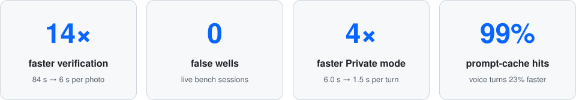
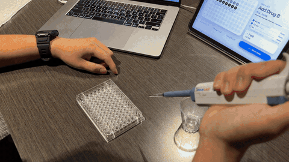
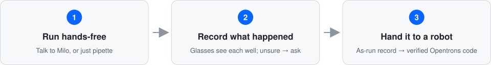
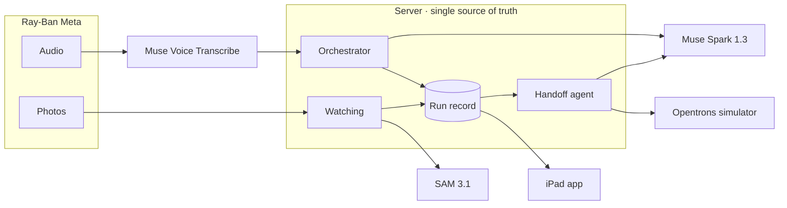
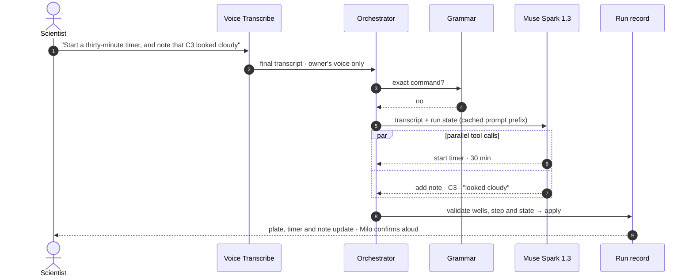
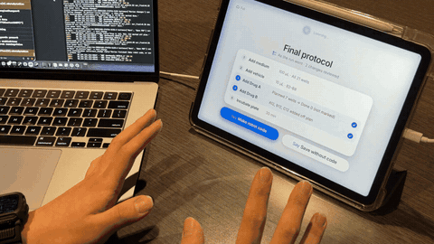

<div align="center">

# Glassistant

### Hands-free lab assistant for Ray-Ban Meta glasses

**It watches the bench, keeps an honest record of the run, and turns it into a verified robot protocol.**

<p>


</p>

<p>
<a href="#-demo"><b>Demo video</b></a> ·
<a href="#-how-it-works"><b>How it works</b></a> ·
<a href="#-orchestration-one-agent-many-tools"><b>Orchestration</b></a> ·
<a href="#-performance"><b>Performance</b></a> ·
<a href="#-try-it-without-hardware"><b>Try it without hardware</b></a> ·
<a href="#-setup"><b>Setup</b></a>
</p>

<sub>Built from scratch in <b>6 days</b> by a team of two for the <a href="https://dev.meta.ai/events/global-hackathon">Meta Global AI Developer Hackathon</a> · Oct 26 – Nov 4, 2026</sub>

</div>

<br/>

<picture>
  <source media="(prefers-color-scheme: dark)" srcset="docs/assets/stats-dark.svg" />
  
</picture>

<!-- GIF slot: hero, 16:9, ~6 s loop of a well appearing on the iPad as the pipette lands.
<p align="center"></p>
-->

## ▶ Demo

> **3-minute demo:** _link added on submission_

Recorded first-person through the glasses, on a real bench, with a real plate and pipette. Every model call in the video is live.

## 💡 Why

A wet-lab scientist spends hours pipetting with gloves on and both hands busy. Inside a clean bench they can't touch notes or a screen, so the record gets written from memory. When the work is later automated, the robot repeats **the plan, not what actually worked**.

Capturing bench work as data is now a frontier of its own: [Transfyr](https://www.synbiobeta.com/read/transfyr-launches-physical-ai-platform-for-science-with-25m-seed-funding) raised a $25M seed in 2026 to build physical-AI infrastructure for exactly this. **Glassistant takes the wearable path**: the scientist's own glasses become the sensor, and Meta's models turn what they see and hear into a record a robot can repeat.

<picture>
  <source media="(prefers-color-scheme: dark)" srcset="docs/assets/loop-dark.svg" />
  
</picture>

## ✨ Highlights

- **One agent drives the whole app.** Muse Spark turns each sentence into validated tool calls, several in parallel, and picks whether to look through the glasses or search the web.
- **Four Meta models, each where it fits.** Voice Transcribe hears, Muse Spark 1.3 reasons and writes code, SAM 3.1 sees, and Muse Glimmer runs privately on our own GPU.
- **The glasses see what you did.** SAM 3.1 finds the plate and the pipette in every photo and places the tip in a well. **Every well shown was in the right place: 9 / 9 with a pen, 4 / 4 with a real pipette.**
- **Vision never overrides a person.** Sure wells are proposed, uncertain ones become a question, and voice always wins.
- **The robot repeats what worked.** Spark writes Opentrons Flex code from the as-run record, and a deterministic verifier checks it in the Opentrons simulator, **well by well and second by second**.
- **Runs without hardware.** Build and run the app with no glasses, Meta account or API key, through Meta's Mock Device Kit.

<div align="center">
<table>
  <tr>
    <td align="center" width="440">
      <a href="https://www.ray-ban.com/usa/ray-ban-meta-smart-glasses"></a><br/>
      <b>Ray-Ban Meta</b><br/><sub>Built and tested · Meta Wearables DAT 1.0</sub>
    </td>
    <td align="center" width="440">
      <a href="https://www.oakley.com/en-us/product/W0OW8001"></a><br/>
      <b>Oakley Meta Vanguard</b><br/><sub>Also supported by DAT · IP67</sub>
    </td>
  </tr>
</table>
</div>

<sub>Both devices are <a href="https://developers.meta.com/wearables/faq/">supported by Meta Wearables DAT</a>. IP67 describes dust and water resistance, not laboratory eye protection.</sub>

## 🧭 How it works



| Principle | What it means |
|---|---|
| **One action path** | Taps, voice and vision go through the same server action, so the run record has a single source of truth. |
| **The model chooses, code verifies** | Deterministic code validates every well, step and line of generated robot code. |
| **Vision never overrides a person** | The scientist's record always wins. Vision proposes; uncertain wells become a question. |

## 🎛 Orchestration: one agent, many tools

**Every input becomes a validated action.** Milo is a single Muse Spark agent that drives the whole app through tool calls. The server, not the model, decides whether each call is allowed and writes it to the run record.



| Layer | What happens | Why it matters |
|---|---|---|
| **1 · Grammar first** | Exact bench commands ("C2 to C4 done", "next step") run without a model | ~0.7 s, deterministic, no tokens |
| **2 · Spark tool calls** | Everything else goes to Muse Spark 1.3 with strict tool schemas; one sentence can fire **several tools in parallel** | Natural speech, no menus |
| **3 · Spark picks the sense** | For a question, Spark decides whether to **open the glasses camera** (SAM 3.1 crops the object, Spark reads only the crop) or **search the web** | The right evidence for each question |
| **4 · Server validates** | Every call is checked against the run (wells, step, state) before it touches the record; taps and vision use the same path | One source of truth |
| **5 · Agent loop for code** | Handoff runs Spark as a loop: `read_run` → `generate_protocol` → `simulate` → fix → `finish` | Code that passes the simulator, not code that looks right |

<!-- TODO before submission: fill from eval/results/tool_choice.md and multi_action.md, then uncomment.
| By the numbers | |
|---|---|
| Tools Milo can call | ⟨N⟩ |
| Tool-choice accuracy on the eval set | ⟨N⟩ / ⟨N⟩ |
| Multi-action sentences handled in one turn | ⟨N⟩ / ⟨N⟩ |
| Agent-loop rounds to a passing protocol (median) | ⟨N⟩ |
-->

## 🧠 Meta models

| Model | Runs on | Used for | Why this model |
|---|---|---|---|
| **Muse Spark 1.3** | Meta Model API | Bench agent, protocol import, photo questions, web search, robot code | PDF and image input, structured output, parallel tool calls, built-in web search |
| **Muse Voice Transcribe** | Meta Model API | Live transcription and turn detection | Streaming speaker diarization (other voices ignored), keyword biasing for well and reagent names |
| **SAM 3.1** | Meta Model API | Plate, well and pipette tracking; label crops | Text- and box-prompted segmentation with pixel masks, no GPUs to manage |
| **Muse Glimmer** | Self-hosted, open weights | Private-mode commands and imports | Distilled from Muse Spark, image input, runs on one GPU we control |

<sub>Non-model tools: Meta Wearables DAT (glasses SDK), OpenCV (feature matching only), ffmpeg, Opentrons API, Apple Speech (Private mode).</sub>

## 👁 Watching

<!-- GIF slot: glasses POV → SAM mask → 👁 on the well, ~5 s.
<p align="center"></p>
-->

During a pipetting step, the app sends **one photo a second** from the glasses.

```
plate   SAM 3.1 finds the plate every third photo, or sooner if the view moves
grid    the first three photos correct the 8 × 12 well grid
tip     SAM 3.1 finds the pipette; the tip is where its inked line ends
well    the tip stays in a well for two photos → counted
sure    the tip is within 3 mm of the well's center
```

| Verdict | What Milo does |
|---|---|
| Sure · in this step | Asks to log it |
| Sure · already logged | Keeps the person's record |
| Sure · not in this step | Asks before logging, or flags it for review if the step has passed |
| Not sure | Asks whether the well was filled |

**Live bench results** — true well order entered before recording.

| Session | Tool | Wells in order | Wells shown | In the right place | False wells | SAM per photo |
|---|---|---|---:|---:|---:|---:|
| 175631 | Pen | A1 → A12 | 9 / 12 | **9 / 9** | **0** | 6.3 s |
| 133607 | Pipette | A2, A3, D4, D5 | 4 / 4 | **4 / 4** | **0** | 8.1 s |

Every well Watching showed was in the right place. In 133607, A3 sat 3.7 mm off center, so Milo **asked instead of guessing**.

<details>
<summary><b>How Watching got from 84 s to 6 s</b></summary>
<br/>

| Change | Commit | Result |
|---|---|---|
| Video clips, plate and tip tracked | — | 84 s from dwell to mark |
| Tip-only tracking, stages run side by side | — | 32–38 s |
| One photo a second instead of video clips | `16af553` | Wells show in seconds |
| Plate found every third photo, or when the view moves | `70c79fb` | No queue: 4.9–5.9 s per photo for the whole session |
| Grid corrected from the first three photos | `9c5f946` | No row-off wells |
| Outer cells reach 2 mm further | `8849365` | 12th-column wells read correctly |
| The whole pipette is found and its inked tip followed | `e670da6` | Works with a real pipette, not only a pen |

</details>

## 🤖 Robot handoff

<!-- GIF slot: review screen → simulator ✓ → protocol.py on a laptop, ~6 s.
<p align="center"></p>
-->

After a run, the code lists what changed from the plan and builds the **as-run** protocol from the record. Muse Spark writes the Opentrons Flex code, but **it does not decide whether that code is right**. The code runs in the Opentrons simulator, and a deterministic verifier compares the simulator's command log with the approved record.

A protocol passes only if:

- ✅ every step runs once, in order, under its `Step N` comment, and nothing moves liquid outside a step
- ✅ each transfer fills exactly its wells, at its volume, from its reservoir well
- ✅ each transfer uses the pipette the code chose, with a new tip for every well
- ✅ each wait lasts the seconds the record holds, and no liquid moves during it
- ✅ no container gives more than it holds above its dead volume

A failed check names the step and the reason, for example `D4 got 20 µL, not 25`, and Spark fixes the code.

## 🔒 Private mode

| | Full | Private |
|---|---|---|
| Commands, imports | Muse Spark 1.3 | **Muse Glimmer** |
| Speech | Muse Voice Transcribe | **Apple Speech on the iPad** |
| Web search, photo questions | Meta Model API | Asks first, then Meta Model API |
| Watching, robot handoff | On | Off |

**The run record is never sent to the Meta Model API.** Glimmer runs on a GPU you host, not on the iPad or the glasses. To deploy it on your own Modal account, see [`server/private/README.md`](server/private/README.md).

## 📈 Performance

Every number was measured on this project. Medians over 5–10 turns unless noted.

| | Before | After | How |
|---|---:|---:|---|
| **Well verification** (SAM 3.1) | 84 s | **~6 s / photo** | One photo a second, judged as each arrives |
| Server compute per photo | 1.25 s | **0.53 s** | Each mask decoded once instead of four or five times |
| SAM per photo, 105 s session | 18 s, growing | **4.9–5.9 s, flat** | Plate re-found every third photo or on view change, capped at one call per 2 s |
| Wait after Watching stops | 26 s | **1.9–3.1 s** | Wells judged during recording, not after |
| SAM 3.1 server errors | 3 clips | **0** | Clips re-encoded before upload (GOP = frame rate, no B-frames) |
| **Voice turn** (Muse Spark) | 1.78 s | **1.37 s** | Prompt restructured so 99% of input tokens hit the cache |
| **Private-mode turn** (Muse Glimmer) | 6.0 s | **1.5 s** | DFlash speculative decoding, zero reasoning budget, prompt caching |
| Glimmer decode | 27 tok/s | **~100 tok/s** | Same change |
| Glimmer prefill | 1.75 s | **~0.3 s** | Prompt caching |

## 🧪 Try it without hardware

> **For judges.** No glasses, Meta account or API key needed. Needs a Mac with Xcode 26 and [uv](https://docs.astral.sh/uv/).

**1. Server** — keep it running

```bash
python3 -m venv .venv
.venv/bin/pip install -r server/requirements.txt
uv venv --python 3.12 .venv-sim
uv pip install --python .venv-sim/bin/python opentrons
MODEL_MODE=recorded .venv/bin/uvicorn server.api:app --port 8000
```

**2. App** — in a second terminal, on the iPad simulator

```bash
cd ios/Meta-Global-AI-Developer-Hackathon
cp Secrets.example.xcconfig Secrets.xcconfig
xcodebuild -scheme Meta-Global-AI-Developer-Hackathon \
  -destination 'platform=iOS Simulator,name=iPad Pro 13-inch (M5)' \
  -derivedDataPath build CODE_SIGNING_ALLOWED=NO build
xcrun simctl boot 'iPad Pro 13-inch (M5)'; open -a Simulator
xcrun simctl install booted build/Build/Products/Debug-iphonesimulator/*.app
xcrun simctl launch booted com.dongchankim.Meta-Global-AI-Developer-Hackathon -demo
```

**3. Run it** — `-demo` pairs mock glasses through Meta's Mock Device Kit and shows a text box in place of the microphone. Open **Demo protocol** on Home and start a run, then type `B2 to B4 done` and `next step`. On the last step, `finish` ends the run. Review the changes it lists, then choose to make robot code.

<table>
  <tr>
    <th width="50%">✅ Works without a key</th>
    <th width="50%">🔑 Needs a key or hardware</th>
  </tr>
  <tr valign="top">
    <td>
      • Screens, plate and run record<br/>
      • Typed commands: wells, steps, timers, notes — same action path as voice<br/>
      • Mock glasses and video, through Meta's real SDK<br/>
      • Preloaded demo protocol<br/>
      • Robot handoff with the real Opentrons simulator and verifier<sup>*</sup>
    </td>
    <td>
      • Free-form questions, web search, photo questions<br/>
      • Importing a new protocol<br/>
      • Voice (replaced by the text box)<br/>
      • Watching (needs glasses and SAM 3.1)<br/>
      • Private mode (needs the self-hosted model)
    </td>
  </tr>
</table>

<sub><sup>*</sup> In this mode the robot code comes from a deterministic stand-in for Muse Spark. No model replies are stored, and <code>MODEL_MODE=recorded</code> blocks every outside network call.</sub>

## 🛠 Setup

**Requirements** · Python 3.11+ · ffmpeg · [uv](https://docs.astral.sh/uv/) · Xcode 26+ · iPad on iPadOS 26+ · Meta Model API key · Ray-Ban Meta glasses with DAT access

<details open>
<summary><b>Server</b></summary>

```bash
python3 -m venv .venv
.venv/bin/pip install -r server/requirements.txt
cp .env.example .env    # set MODEL_API_KEY to your own Meta Model API key
.venv/bin/uvicorn server.api:app --host 0.0.0.0 --port 8000
```
</details>

<details open>
<summary><b>iPad app</b></summary>

```bash
cd ios/Meta-Global-AI-Developer-Hackathon
cp Secrets.example.xcconfig Secrets.xcconfig    # server URL, development team
open Meta-Global-AI-Developer-Hackathon.xcodeproj
```

Run on an iPad on the same network as the server.
</details>

<details>
<summary><b>Robot simulator</b></summary>

```bash
uv venv --python 3.12 .venv-sim
uv pip install --python .venv-sim/bin/python opentrons
```
</details>

<details>
<summary><b>API keys</b></summary>

Use your own keys. None are in this repo, and `.env` is gitignored.

| Setting in `.env` | Needed for | How to get it |
|---|---|---|
| `MODEL_API_KEY` | Everything that calls Muse Spark, Voice Transcribe or SAM 3.1 | Your Meta Model API key |
| `PRIVATE_LLM_URL` | Private mode only (optional) | Deploy Muse Glimmer to your own Modal account: [`server/private/README.md`](server/private/README.md) |
| `MODEL_MODE=recorded` | Running with no key | Nothing; see [Try it without hardware](#-try-it-without-hardware) |

```bash
cp .env.example .env    # then fill in the values above
```
</details>

## 📁 Repository

```
ios/       SwiftUI iPad app — Bench, plate map, voice session, glasses stream, Watching
server/    FastAPI server — orchestrator, run record, Watching, robot handoff, Private mode
shared/    Screen registry and voice grammar shared by app and server
eval/      Evaluation scripts, results and the log of every tuned threshold
samples/   Demo protocols (synthetic data)
docs/      Design notes
```

## 👥 Team

| | Role |
|---|---|
| **Dongchan Kim** | Team lead · engineering |
| **Eunbi [last name]** | Product and interaction design |

<sub>Everything in this repository was built during the hackathon. All data is synthetic.</sub>
