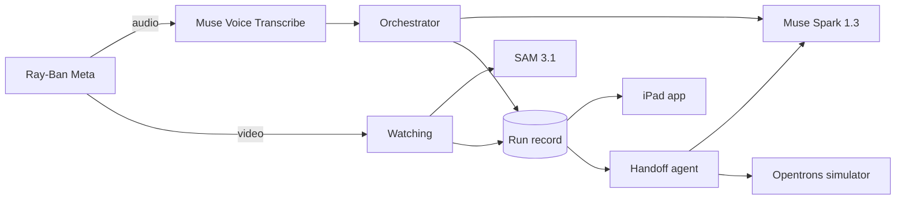

<div align="center">

# Glassistant

<p align="center">
  
  
  
  
</p>

Hands-free lab assistant for Ray-Ban Meta glasses. It tracks a wet-lab run by voice and vision, keeps a record of what actually happened, and turns that record into a verified Opentrons protocol.

</div>

<table>
  <tr>
    <td colspan="2" align="center">
      <a href="https://x.com/MetaforDevs/status/2103237819993137592/photo/1">
    
  </a><br />
      <sub>Built for the <a href="https://dev.meta.ai/events/global-hackathon">Meta Global AI Developer Hackathon</a> · <a href="https://x.com/MetaforDevs/status/2103237819993137592/photo/1">Original announcement</a></sub>
    </td>
  </tr>
  <tr>
    <td colspan="2" align="center">
      <a href="https://about.fb.com/news/2026/04/introducing-muse-spark-meta-superintelligence-labs/"></a>
      <picture>
        <source media="(prefers-color-scheme: dark)" srcset="https://raw.githubusercontent.com/lobehub/lobe-icons/refs/heads/master/packages/static-png/dark/metaai-text.png" />
        
      </picture><br /><br />
      <sub>Muse Spark 1.3 · Muse Glimmer 30B · SAM 3.1</sub>
    </td>
  </tr>
  <tr>
    <td width="415" align="center">
      <a href="https://www.ray-ban.com/usa/ray-ban-meta-smart-glasses"></a><br />
      <strong>Ray-Ban Meta</strong><br />
      <sub>Current prototype · Meta Wearables DAT 1.0</sub>
    </td>
    <td width="415" align="center">
      <a href="https://www.oakley.com/en-us/product/W0OW8001"></a><br />
      <strong>Oakley Meta Vanguard</strong><br />
      <sub>Planned device validation · Meta Wearables DAT 1.0<br />
      IP67 dust and water resistance · Wrap-around design</sub>
    </td>
  </tr>
</table>

<sub>Both devices are <a href="https://developers.meta.com/wearables/faq/">supported by Meta Wearables DAT</a>; capabilities vary by device. <a href="https://www.meta.com/ai-glasses/oakley-meta-vanguard-black-prizm-black/">Vanguard’s IP67 rating</a> describes dust and water resistance, not laboratory eye-protection certification.</sub>

**Demo:** _link to be added on submission_ · [Try it without hardware](#try-it-without-hardware)

## Features

- **Voice control:** log wells, advance steps, start timers and add notes without touching a screen.
- **Watching:** follows the pipette tip through the glasses camera and logs the well. If unsure, it asks.
- **Protocol import:** extracts steps, wells and reagents from a PDF, photo or text, with source evidence for review.
- **Questions in context:** reads labels from a glasses photo and answers web questions with sources.
- **Robot handoff:** generates an Opentrons Flex protocol from the approved run and checks it against the record in simulation.
- **Private mode:** runs voice commands and imports on Muse Glimmer instead of the Meta Model API.

## Architecture



Taps, voice and vision share one server action path, so the run record has a single source of truth. The model chooses; deterministic code validates wells, steps and generated robot code. Vision never overrides a person's record.

## Models

| Model | Runs on | Used for |
|---|---|---|
| Muse Spark 1.3 | Meta Model API | Bench agent, protocol import, photo questions, web search, robot code |
| Muse Voice Transcribe | Meta Model API | Live transcription and turn detection |
| SAM 3.1 | Meta Model API | Plate, well and pipette-tip tracking; label crops |
| Muse Glimmer | Self-hosted (open weights) | Private mode commands and imports |

## Watching

The glasses stream 720×1280 video at 7 fps, analysed in 10-second chunks. SAM 3.1 finds the plate and wells and tracks the tip; ORB + RANSAC keep the plate aligned. A well counts when the tip stays within 4.5 mm of it for at least 1.0 s while still.

| Verdict | Action |
|---|---|
| Sure, in this step | Log it and announce it |
| Sure, already logged | Keep the person's record |
| Sure, not in this step | Ask before logging |
| Not sure | Ask whether the well was filled |

Results from real-bench sessions, with the true well order entered before recording. These are early and small, not a held-out set.

| Session | Tool | Correct positions | Wrong sure verdicts |
|---|---|---:|---:|
| 215941 | Pipette tip | 6 / 6 | 0 |
| 215638 | Pipette tip | 0 / 6 (all deferred as not sure) | 0 |
| 224714 | Pen | 9 / 9 | 0 |
| 001735 | Pen | 7 / 7 | 0 |

## Private mode

| | Full | Private |
|---|---|---|
| Commands, imports | Muse Spark 1.3 | Muse Glimmer |
| Speech | Muse Voice Transcribe | Apple Speech on the iPad |
| Web search, photo questions | Meta Model API | Asks first, then Meta Model API |
| Watching, robot handoff | On | Off |

The run record is never sent to the Meta Model API. To deploy Glimmer, see [`server/private/README.md`](server/private/README.md).

## Try it without hardware

No glasses, Meta account or API key needed. This confirms the app runs; the demo video shows the full product. Needs a Mac with Xcode 26 and [uv](https://docs.astral.sh/uv/).

**1. Server** (keep it running)

```bash
python3 -m venv .venv
.venv/bin/pip install -r server/requirements.txt
uv venv --python 3.12 .venv-sim
uv pip install --python .venv-sim/bin/python opentrons
MODEL_MODE=recorded .venv/bin/uvicorn server.api:app --port 8000
```

**2. App** (a second terminal, on the iPad simulator)

```bash
cd ios/Meta-Global-AI-Developer-Hackathon
cp Secrets.example.xcconfig Secrets.xcconfig
xcodebuild -scheme Meta-Global-AI-Developer-Hackathon \
  -destination 'platform=iOS Simulator,name=iPad Pro 13-inch (M5)' \
  -derivedDataPath build CODE_SIGNING_ALLOWED=NO build
xcrun simctl boot 'iPad Pro 13-inch (M5)'; open -a Simulator
xcrun simctl install booted build/Build/Products/Debug-iphonesimulator/*.app
xcrun simctl launch booted com.dongchankim.Meta-Global-AI-Developer-Hackathon -demo
```

`-demo` pairs mock glasses through Meta's Mock Device Kit and shows a text box in place of the microphone. Open **Demo protocol** on Home and start a run, then type commands such as `B2 to B4 done`, `next step` and `finish`.

| Works without a key | Result |
|---|---|
| Screens, plate and run record | Real |
| Typed commands: wells, steps, timers, notes | Real grammar, same action path as voice |
| Mock glasses and video on screen | Real SDK with a mock device, drawn test video |
| Demo protocol | Preloaded |
| Robot handoff | Real Opentrons simulator and verifier. The robot code comes from a deterministic stand-in for Muse Spark |

| Needs a key or hardware | In this mode |
|---|---|
| Free-form questions, web search, photo questions | Milo says it needs a Meta Model API key |
| Importing a new protocol | Milo says it needs a Meta Model API key |
| Voice | Replaced by the text box |
| Watching | Milo points to the demo video (needs glasses and SAM 3.1) |
| Private mode | Milo points to the demo video (needs the self-hosted model) |

No model replies are stored, and `MODEL_MODE=recorded` blocks every outside network call.

## Setup

**Requirements:** Python 3.11+, ffmpeg, [uv](https://docs.astral.sh/uv/), Xcode 26+, an iPad on iPadOS 26+, a Meta Model API key, and Ray-Ban Meta glasses with DAT access.

**Server**

```bash
python3 -m venv .venv
.venv/bin/pip install -r server/requirements.txt
cp .env.example .env    # add your API key
.venv/bin/uvicorn server.api:app --host 0.0.0.0 --port 8000
```

**Robot simulator**

```bash
uv venv --python 3.12 .venv-sim
uv pip install --python .venv-sim/bin/python opentrons
```

**iPad app**

```bash
cd ios/Meta-Global-AI-Developer-Hackathon
cp Secrets.example.xcconfig Secrets.xcconfig    # server URL, development team
open Meta-Global-AI-Developer-Hackathon.xcodeproj
```

Run on an iPad on the same network as the server.

## Limitations

- One 96-well plate per step, single-channel pipetting.
- Watching is not real-time and depends on lighting and plate placement.
- Robot protocols are verified in simulation only. Review them before running on hardware.
- Ray-Ban Meta glasses are not laboratory eye protection.
