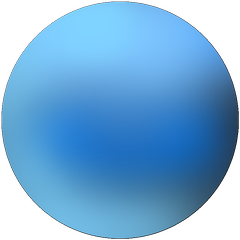
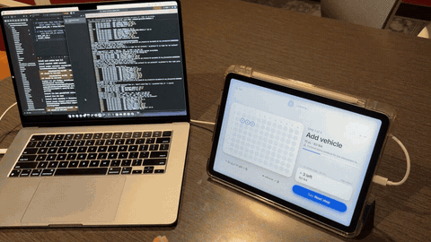
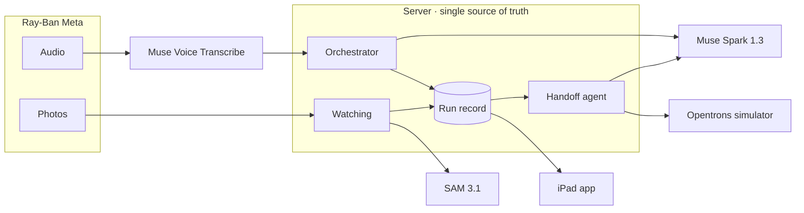
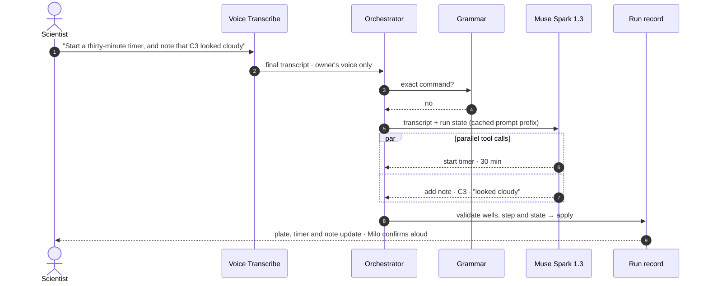

<div align="center">

<p>
  
</p>
<p>
  <picture>
    <source media="(prefers-color-scheme: dark)" srcset="docs/assets/logo-dark.svg" />
    
  </picture>
</p>

<h3>A hands-free lab assistant.</h3>

<p>Meta AI glasses see the bench. Meta models keep the record.<br/>
<em>Voice is the new interface. Speak the run, the glasses check it, a robot repeats it.</em></p>

<p>
<a href="#demo">Demo</a> &nbsp;·&nbsp;
<a href="#see-it-in-action">Features</a> &nbsp;·&nbsp;
<a href="#how-it-works">How it works</a> &nbsp;·&nbsp;
<a href="#performance">Performance</a> &nbsp;·&nbsp;
<a href="#try-it-without-hardware">Try it</a> &nbsp;·&nbsp;
<a href="#setup">Setup</a>
</p>

<p>


</p>

<sub>Theme: <b>Push the Frontier</b> · Built by a team of two during the <a href="https://dev.meta.ai/events/global-hackathon">Meta Global AI Developer Hackathon</a> · Oct 26 – Nov 4, 2026</sub>

</div>

<br/>

## Team

<table>
  <tr>
    <td align="center" width="500">
      <h3>Dongchan Kim</h3>
      Team lead · Engineering<br/>
      <sub>University of Illinois Urbana-Champaign<br/>
      M.S., Systems Engineering</sub><br/><br/>
      <a href="https://github.com/Dongckim">GitHub</a> · <a href="https://www.linkedin.com/in/dongckim99/">LinkedIn</a>
    </td>
    <td align="center" width="500">
      <h3>Eunbi Cho</h3>
      Product & Interaction Design<br/>
      <sub>Carnegie Mellon University<br/>
      MDes, Design for Interactions</sub><br/><br/>
      <a href="https://github.com/Eunnox">GitHub</a> · <a href="https://www.linkedin.com/in/eunbicho-eunnox/">LinkedIn</a>
    </td>
  </tr>
</table>

## Demo

<!-- Replace with the video once it's uploaded, e.g.
<p align="center">
  <a href="https://youtu.be/VIDEO_ID"></a>
</p>
-->

> **3-minute demo:** _link added on submission_

We filmed it through the glasses at a desk, with a real 96-well plate and pipette. Every model call in the video is live.

<br/>

## Why

Wet-lab scientists pipette for hours with gloves on and both hands busy. The record gets written later, from memory, and a robot repeats the plan, not what actually worked.

We interviewed 6 biology PhDs and lab researchers. They leave the bench to write notes and keep research questions in a private AI workspace.

> "When I seed cells, I sometimes forget which wells I've done. I skip the unsure ones, check under the microscope, and seed them again."

[Transfyr](https://www.synbiobeta.com/read/transfyr-launches-physical-ai-platform-for-science-with-25m-seed-funding) raised a $25M seed in 2026 to capture bench work with [three fixed cameras over each workstation](https://www.thestar.com.my/tech/tech-news/2026/09/07/some-scientists-have-magic-hands-in-the-lab-this-ai-is-learning-why), headband cameras, microphones and environmental sensors.

<table width="100%"><tr><td>
<b>Glassistant</b> needs no install: Meta AI glasses, worn like lab goggles, are the sensor, and Milo checks each well during the run.
</td></tr></table>

<picture>
  <source media="(prefers-color-scheme: dark)" srcset="docs/assets/loop-dark.svg" />
  
</picture>

<br/>

## See it in action

<table>
  <tr>
    <td align="center" valign="top" width="33%">
      
      <h4>Watching</h4>
      <sub>The glasses follow the pipette tip and mark each well on the iPad as you fill it.</sub>
    </td>
    <td align="center" valign="top" width="33%">
      
      <h4>Search</h4>
      <sub>Ask a question out loud and Milo answers from the web, without you putting the pipette down.</sub>
    </td>
    <td align="center" valign="top" width="33%">
      
      <h4>Robot handoff</h4>
      <sub>Approve what actually happened, and Spark writes Opentrons Flex code that passes the simulator.</sub>
    </td>
  </tr>
</table>

<br/>

## Highlights

<picture>
  <source media="(prefers-color-scheme: dark)" srcset="docs/assets/stats-dark.svg" />
  
</picture>

- **One agent**: Milo, a Muse Spark agent, turns speech into tool calls, several at once, and picks the glasses camera or the web.
- **Four Meta models**: Voice Transcribe listens, Muse Spark 1.3 thinks and writes code, SAM 3.1 sees, Muse Glimmer runs Private mode.
- **Vision**: SAM 3.1 tracks the plate and pipette tip. Every well shown was right: 9 / 9 with a pen, 4 / 4 with a pipette.
- **Human first**: Sure wells are suggested, unsure ones become a question, and your voice always wins.
- **Robot handoff**: Spark writes Opentrons Flex code from what actually happened, checked well by well in the simulator.

<div align="center">
<table>
  <tr>
    <td align="center" width="440">
      <a href="https://www.ray-ban.com/usa/ray-ban-meta-smart-glasses"></a><br/>
      <b>Ray-Ban Meta</b><br/><sub>Built and tested · Meta Wearables DAT 1.0</sub>
    </td>
    <td align="center" width="440">
      <a href="https://www.oakley.com/en-us/product/W0OW8001"></a><br/>
      <b>Oakley Meta Vanguard</b><br/><sub>Also supported by DAT · IP67</sub>
    </td>
  </tr>
</table>
</div>

<sub>Both devices are <a href="https://developers.meta.com/wearables/faq/">supported by Meta Wearables DAT</a>. We built and tested on Ray-Ban Meta. Oakley Meta Vanguard, sealed to IP67 against dust and water, is our next step toward real lab use.</sub>

## How it works



Three rules hold the design together:

- **One way in.** Taps, voice and vision all go through the same server action, so there is only one run record.
- **The model picks, code checks.** Plain code checks every well, every step and every line of robot code the model writes.
- **Vision never overrides a person.** Vision suggests. If it isn't sure, it asks.

## Orchestration: Milo

Milo is our agent: one Muse Spark agent that runs the app through tool calls. The server, not the model, decides whether each call is allowed and writes it to the run record.



| Step | What happens | Why |
|---|---|---|
| 1. Grammar first | Exact bench commands like "C2 to C4 done" or "next step" skip the model | About 0.1 s on the server, same result every time, no tokens |
| 2. Spark tool calls | Everything else goes to Muse Spark 1.3 with strict tool schemas. One sentence can trigger several tools at once | You talk normally, no menus |
| 3. Spark picks the source | For a question, Spark decides whether to take a photo with the glasses (SAM 3.1 crops the object and Spark reads only the crop) or search the web | The right evidence for each question |
| 4. Server checks | Every call is checked against the run (wells, step, state) before it changes the record. Taps and vision go the same way | One source of truth |
| 5. Agent loop for code | Handoff runs Spark in a loop: `read_run` → `generate_protocol` → `simulate` → fix → `finish` | Code that passes the simulator, not code that only looks right |

| By the numbers | |
|---|---|
| Actions Milo can call | 42 |
| Right outcome on the tool-choice set (28 spoken requests, 4 runs) | 25–27 / 28 |
| Every action done, for sentences that ask for two or three things | 30 / 33, up from 10 / 30 |
| Actions dropped without a word | 0 / 33, down from 20 / 30 |

<sub>Live Muse Spark 1.3 runs, one fresh session each. The scripts are in <code>eval/</code> (<code>tool_choice.py</code>, <code>multi_action.py</code>).</sub>

## Meta models

Each model does one job that the bench needs, and each was picked for a capability that job can't do without.

| Model | Its job | Why this model |
|---|---|---|
| **Muse Voice Transcribe**<br/><sub>Meta Model API</sub> | Hears the scientist, live | **Speaker separation in the live stream.** A lab is shared and loud. Voice Transcribe labels who is speaking as it transcribes, so only the owner's turns reach Milo and a labmate's "C3 is done" is ignored. **Keyword biasing** with this protocol's reagents, its wells and our command words keeps lab terms from being misheard. One stream does both, with no separate diarization pass. |
| **Muse Spark 1.3**<br/><sub>Meta Model API</sub> | Reads the protocol, runs the app, writes robot code | **Reads the PDF as it is.** The protocol goes in as a file, with no OCR or parsing step of our own. **Agent-grade tool calling.** Strict schemas and several tool calls from one sentence let one model drive every screen. **Built-in web search** answers reagent questions without another service. **Prompt caching** lets 99% of each turn's input hit the cache. Import, agent, search and code all run on one model with one prompt and tool contract. |
| **SAM 3.1**<br/><sub>Meta Model API</sub> | Finds the plate and the pipette tip in every photo | **Text prompts, no training.** It segments "microplate" and "pipette" from a word, so we didn't need a labeled dataset of our plates and pipettes. **Pixel masks, not boxes.** The tip is where the inked line on the pipette ends, which a bounding box can't show. Hosted on the Meta Model API, so there are no GPUs for us to run. |
| **Muse Glimmer**<br/><sub>open weights, self-hosted</sub> | Private mode | **Open weights.** It runs on a GPU you control, so the run record never leaves your hands. **A drop-in for Spark.** It takes the same instructions, tools and output format, so Private mode is the same agent, not a second app. **Image input** keeps page imports working. With DFlash speculative decoding a turn takes 1.5 s. |

<sub>Other tools: Meta Wearables DAT (glasses SDK), OpenCV (feature matching only), ffmpeg, the Opentrons API, Apple Speech (Private mode).</sub>

## Watching

<!-- GIF slot: glasses POV → SAM mask → eye mark on the well, ~5 s.
<p align="center"></p>
-->

During a pipetting step the app sends one photo a second from the glasses.

```
plate   SAM 3.1 finds the plate every third photo, or sooner if the view moves
grid    the first three photos correct the 8 × 12 well grid
tip     SAM 3.1 finds the pipette; the tip is where its inked line ends
well    the tip stays in a well for two photos → counted
sure    the tip is within 3 mm of the well's center
```

| What vision saw | What Milo does |
|---|---|
| Sure, and the well is in this step | Asks to log it |
| Sure, but you already logged it | Keeps your record |
| Sure, but the well isn't in this step | Asks before logging, or flags it for review if the step is over |
| Not sure | Asks whether you filled the well |

**Results from two live sessions.** Each is a single session, not a test set.

| Session | Tool | Wells, in order | Wells shown | In the right place | False wells | SAM per photo |
|---|---|---|---:|---:|---:|---:|
| 175631 | Pen | A1 → A12 | 9 / 12 | 9 / 9 | 0 | 6.3 s |
| 133607 | Pipette | A2, A3, D4, D5 | 4 / 4 | 4 / 4 | 0 | 8.1 s |

Every well Watching showed was in the right place. In 133607, A3 was 3.7 mm off center, so Milo asked instead of guessing. Three wells were missed in 175631, and a stay shorter than about 3 s can be missed because SAM doesn't find the pipette in every photo.

<details>
<summary><b>How Watching got from 84 s to 6 s</b></summary>
<br/>

| Change | Commit | Result |
|---|---|---|
| Video clips, tracking the plate and the tip | — | 84 s from the tip landing to the mark |
| Tracking the tip only, running stages side by side | — | 32–38 s |
| Grid corrected from the first three photos | `9c5f946` | No more wells read a row off |
| Plate found every third photo, or when the view moves | `70c79fb` | Photos no longer queue up |
| Outer cells reach 2 mm further | `8849365` | 12th-column wells read correctly |
| Watching on the bench uses one photo a second instead of video | `16af553` | Wells show within seconds |
| The whole pipette is found and its inked tip followed | `e670da6` | Works with a real pipette, not only a pen |

</details>

## Robot handoff

<!-- GIF slot: review screen → simulator check → protocol.py on a laptop, ~6 s.
<p align="center"></p>
-->

After a run, the app lists what changed from the plan and builds the as-run protocol from the record. Muse Spark writes the Opentrons Flex code, but it doesn't get to decide whether the code is right. The code runs in the Opentrons simulator, and plain code compares the simulator's command log with the record you approved.

A protocol passes only if:

- every step runs once, in order, under its `Step N` comment, and no liquid moves outside a step
- each transfer fills exactly its wells, at its volume, from its reservoir well
- each transfer uses the pipette the code picked, with a new tip for every well
- each wait lasts as long as the record says, and no liquid moves during it
- no container gives more than it holds above its dead volume

When a check fails, it names the step and the reason, for example `D4 got 20 µL, not 25`, and Spark fixes the code.

## Private mode

| | Full | Private |
|---|---|---|
| Commands, imports | Muse Spark 1.3 | Muse Glimmer |
| Speech | Muse Voice Transcribe | Apple Speech on the iPad |
| Web search, photo questions | Meta Model API | Asks first, then Meta Model API |
| Watching, robot handoff | On | Off |

In Private mode the run record is never sent to the Meta Model API. Glimmer runs on a GPU you host, not on the iPad or the glasses. To deploy it on your own Modal account, see [`server/private/README.md`](server/private/README.md).

## Performance

We measured all of these on this project. They are medians over 5–10 turns unless noted.

| | Before | After | How |
|---|---:|---:|---|
| Well verification (SAM 3.1) | 84 s | ~6 s per photo | One photo a second, each judged when it arrives |
| Server compute per photo | 1.25 s | 0.53 s | Each mask decoded once instead of four or five times |
| SAM per photo over a 105 s session | 18 s and growing | 4.9–5.9 s, flat | Plate found again only every third photo or when the view moves |
| Wait after Watching stops | 26 s | 1.9 s (pen) – 9.2 s (pipette) | Wells judged during recording, not after |
| SAM 3.1 server errors | 3 clips | 0 | Clips re-encoded before upload (a keyframe every second, no B-frames) |
| Voice turn (Muse Spark) | 1.78 s | 1.37 s | Prompt reordered so 99% of input tokens hit the cache |
| Private-mode turn (Muse Glimmer) | 6.0 s | 1.5 s | DFlash speculative decoding, no reasoning budget, prompt caching |
| Glimmer decode | 27 tok/s | ~100 tok/s | Same change |
| Glimmer prefill | 1.75 s | ~0.3 s | Prompt caching |

## Try it without hardware

> **For judges.** No glasses, Meta account, Apple Developer account or API key needed. You need a Mac with Xcode 26.5 (with an iPad simulator installed) and [uv](https://docs.astral.sh/uv/). uv installs Python 3.12 for you.

**1. Server.** Leave it running.

```bash
uv venv --python 3.12 .venv
uv pip install --python .venv/bin/python -r server/requirements.txt
uv venv --python 3.12 .venv-sim
uv pip install --python .venv-sim/bin/python opentrons
MODEL_MODE=recorded .venv/bin/uvicorn server.api:app --port 8000
```

**2. App.** In a second terminal, on the iPad simulator. If you don't have `iPad Pro 13-inch (M5)`, use any iPad listed by `xcrun simctl list devices`.

```bash
cd ios/Meta-Global-AI-Developer-Hackathon
cp Secrets.example.xcconfig Secrets.xcconfig
xcodebuild -scheme Meta-Global-AI-Developer-Hackathon \
  -destination 'platform=iOS Simulator,name=iPad Pro 13-inch (M5)' \
  -derivedDataPath build CODE_SIGNING_ALLOWED=NO build
xcrun simctl boot 'iPad Pro 13-inch (M5)'; open -a Simulator
xcrun simctl install booted build/Build/Products/Debug-iphonesimulator/*.app
xcrun simctl launch booted com.dongchankim.Meta-Global-AI-Developer-Hackathon -demo
```

**3. Run it.** `-demo` connects mock glasses through Meta's Mock Device Kit and puts a text box where the microphone would be. Open **Demo protocol** on Home and start a run. Type `B2 to B4 done`, then `next step`. On the last step, type `finish`. Look over the changes it lists, then choose to make robot code.

<table>
  <tr>
    <th width="50%">Works without a key</th>
    <th width="50%">Needs a key or hardware</th>
  </tr>
  <tr valign="top">
    <td>
      • Screens, plate and run record<br/>
      • Typed commands for wells, steps, timers and notes, using the same path as voice<br/>
      • Mock glasses and video, through Meta's real SDK<br/>
      • The preloaded demo protocol<br/>
      • Robot handoff with the real Opentrons simulator and checker<sup>*</sup>
    </td>
    <td>
      • Free-form questions, web search, photo questions<br/>
      • Importing a new protocol<br/>
      • Voice (the text box replaces it)<br/>
      • Watching (needs glasses and SAM 3.1)<br/>
      • Private mode (needs the self-hosted model)
    </td>
  </tr>
</table>

<sub><sup>*</sup> In this mode the robot code comes from a fixed stand-in for Muse Spark. No model replies are stored, and <code>MODEL_MODE=recorded</code> blocks every outside network call.</sub>

## Setup

**What you need**

- A Mac with Xcode 26.5, ffmpeg and [uv](https://docs.astral.sh/uv/) (the server needs Python 3.12 or newer)
- An iPad on iPadOS 26 or newer
- An Apple ID. A free account (Personal Team) is enough; you don't need a paid Apple Developer membership.
- A Meta Model API key
- Ray-Ban Meta glasses and the Meta AI app on the iPad

<details open>
<summary><b>Server</b></summary>

```bash
uv venv --python 3.12 .venv
uv pip install --python .venv/bin/python -r server/requirements.txt
cp .env.example .env    # set MODEL_API_KEY to your own Meta Model API key
.venv/bin/uvicorn server.api:app --host 0.0.0.0 --port 8000
```

`--host 0.0.0.0` lets the iPad reach the server over your Wi-Fi.
</details>

<details open>
<summary><b>iPad app</b></summary>

```bash
cd ios/Meta-Global-AI-Developer-Hackathon
cp Secrets.example.xcconfig Secrets.xcconfig
open Meta-Global-AI-Developer-Hackathon.xcodeproj
```

1. In `Secrets.xcconfig`, set `SERVER_BASE_URL = http:/$()/<your Mac's IP>:8000`. `localhost` only works in the simulator. The `$()` stops Xcode from reading `//` as a comment.
2. In Xcode, select the `Meta-Global-AI-Developer-Hackathon` target and open **Signing & Capabilities**. Set **Team** to your own Apple ID and change **Bundle Identifier** to something unique, like `com.yourname.glassistant`. Change the Team here, not in `Secrets.xcconfig`, because the target's setting wins.
3. On the iPad, turn on Developer Mode (Settings → Privacy & Security). After the first install, trust your certificate under Settings → General → VPN & Device Management. With a free Apple ID the app stops opening after 7 days; run it from Xcode again.
4. Put the iPad on the same Wi-Fi as the Mac, run the app from Xcode, and allow Local Network, Bluetooth, Microphone and Speech Recognition when it asks.
</details>

<details open>
<summary><b>Glasses</b></summary>

1. Install the Meta AI app on the iPad and pair your glasses. Update both to the versions Meta lists for DAT SDK 1.0.1 in its [version dependencies](https://wearables.developer.meta.com/docs/develop/dat/version-dependencies).
2. Turn on Developer Mode in Meta AI: Settings → App Info, then tap the version number 5 times.
3. With Developer Mode on, `META_APP_ID` and `CLIENT_TOKEN` in `Secrets.xcconfig` can stay empty, and you don't need a Meta developer account.
4. The first time you connect, Glassistant opens Meta AI so you can register the app.

The DAT SDK is a public Swift package (`github.com/facebook/meta-wearables-dat-ios`, 1.0.1). Xcode downloads it on its own, no login needed.
</details>

<details>
<summary><b>Robot simulator</b></summary>

```bash
uv venv --python 3.12 .venv-sim
uv pip install --python .venv-sim/bin/python opentrons
```
</details>

<details>
<summary><b>API keys</b></summary>

Use your own keys. None are in this repo, and `.env` and `Secrets.xcconfig` are gitignored.

| Setting in `.env` | Needed for | How to get it |
|---|---|---|
| `MODEL_API_KEY` | Anything that calls Muse Spark, Voice Transcribe or SAM 3.1 | Your Meta Model API key |
| `PRIVATE_LLM_URL` | Private mode only (optional) | Deploy Muse Glimmer to your own Modal account: [`server/private/README.md`](server/private/README.md) |
| `MODEL_MODE=recorded` | Running without a key | Nothing; see [Try it without hardware](#try-it-without-hardware) |

```bash
cp .env.example .env    # then fill in the values above
```
</details>

<details>
<summary><b>Tests</b></summary>

Server tests are plain scripts. Run each one on its own, for example:

```bash
.venv/bin/python -m server.tests.test_recorded
```

`test_private_guard` and `test_private_wake` also need `uv pip install --python .venv/bin/python modal`.
</details>

## Repository

```
ios/       SwiftUI iPad app: bench screen, plate map, voice session, glasses stream, Watching
server/    FastAPI server: orchestrator, run record, Watching, robot handoff, Private mode
shared/    Screen list and voice grammar shared by the app and the server
eval/      Evaluation scripts and the log of every tuned Watching threshold (results stay local)
samples/   Demo protocols (made-up data)
docs/      Design notes and README images
```

<sub>Everything in this repository was built during the hackathon. The demo protocols and sample run data are synthetic. The sessions, timings and recordings in this README come from real runs.</sub>

## License

The code in this repository is released under the [MIT License](LICENSE), © 2026 Dongchan Kim and Eunbi Cho.

Nothing below is bundled in this repository. Each part is downloaded when you set the project up and keeps its own terms.

| Component | Used for | License or terms |
|---|---|---|
| Meta Wearables Device Access Toolkit 1.0.1 | Glasses audio, photos and Mock Device Kit | [Meta Wearables Developer Terms](https://wearables.developer.meta.com/terms) and [Acceptable Use Policy](https://wearables.developer.meta.com/acceptable-use-policy) |
| Muse Spark, Voice Transcribe, SAM 3.1 | Hosted models | Meta Model API terms of your own account |
| `meta-sam-parser` | Reading SAM 3.1 responses | SAM License |
| Muse Glimmer 30B weights and DFlash drafter ([`meta-models/Muse-Glimmer-30B-GGUF`](https://huggingface.co/meta-models/Muse-Glimmer-30B-GGUF)) | Private mode | Apache-2.0 |
| llama.cpp | Serving Glimmer | MIT |
| Opentrons API | Robot simulator | Apache-2.0 |
| OpenCV (`opencv-python-headless`) | Feature matching | Apache-2.0 |
| FastAPI, jsonschema, Pillow | Server | MIT, MIT, MIT-CMU |
| Uvicorn, httpx, python-dotenv, pypdf, websockets | Server | BSD-3-Clause |
| python-multipart | Server | Apache-2.0 |
| ffmpeg | Re-encoding clips, called as a separate program | LGPL or GPL, depending on your build |
